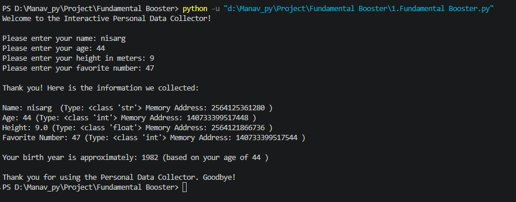

# Interactive Personal Data Collector

This Python project collects personal information such as name, age, height, and favorite number. It displays each value along with its data type and memory address, and calculates the user's approximate birth year.

## Output

